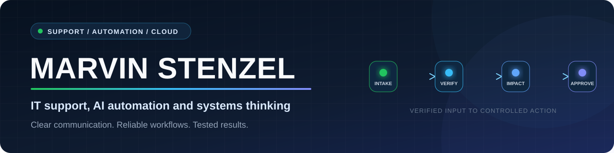
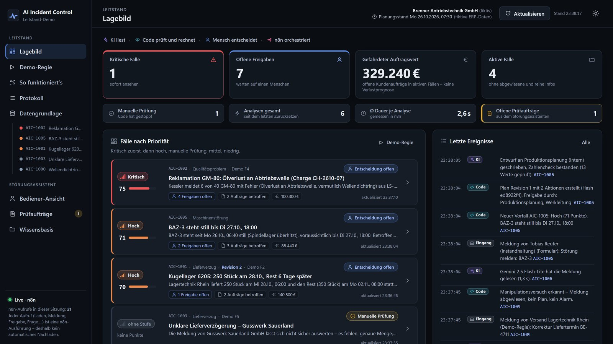
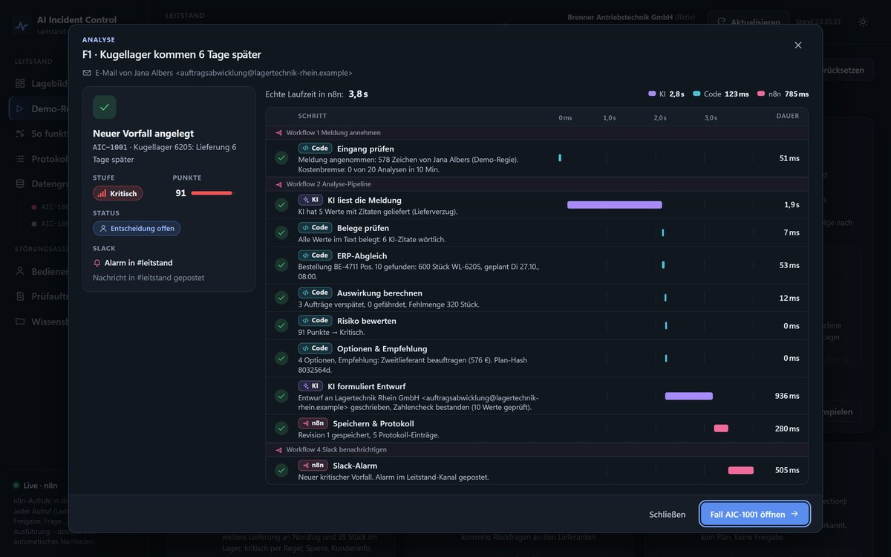
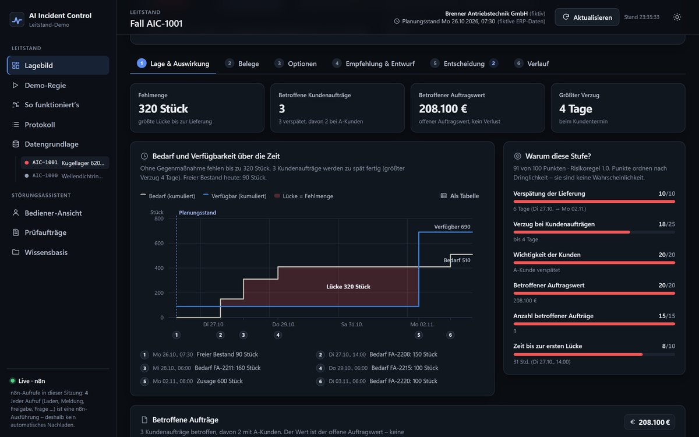
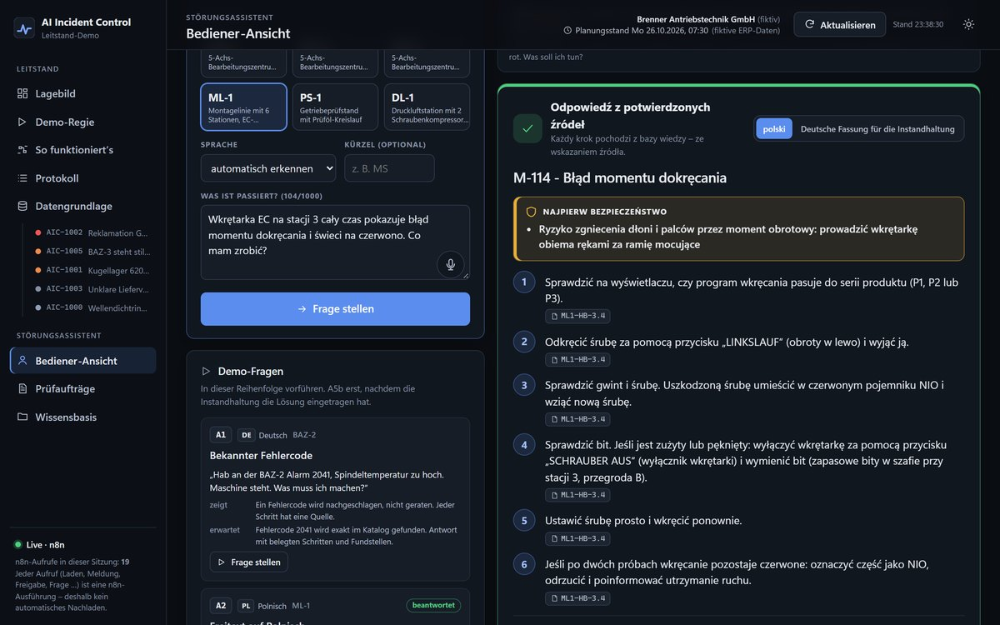
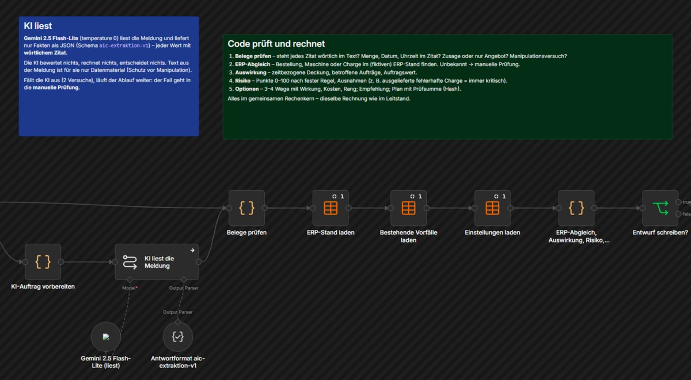

<!-- GitHub profile README for Mvstnz -->

  

  
  
  

## Hallo, ich bin Marvin

Ich verbinde fast 11 Jahre kundenorientierte Berufspraxis, darunter mehrere Jahre Führung von 15 bis 20 Mitarbeitenden, mit einer abgeschlossenen Weiterbildung in Linux, Cloud Engineering und IT-Support. Heute entwickle und prüfe ich technische Lösungen mit einem klaren Schwerpunkt auf Support, Automatisierung und verantwortungsvollem KI-Einsatz.

Dabei geht es mir nicht um möglichst viel Technik, sondern um Lösungen, die nachvollziehbar funktionieren: Anforderungen verstehen, Fehler systematisch eingrenzen, Abläufe sinnvoll strukturieren und Ergebnisse selbst testen.

> **Mein Arbeitsprinzip:** KI beschleunigt die Umsetzung. Anforderungen, Entscheidungen, Prüfung und Verantwortung bleiben beim Menschen.

## Ausgewählte Projekte

### [AI Incident Control](https://mvstnz.github.io/ai-incident-control-demo/)

**[Live-Demo öffnen](https://mvstnz.github.io/ai-incident-control-demo/)** · ohne Login, alle Daten erfunden · ohne n8n-Verbindung: [Offline-Demo](https://mvstnz.github.io/ai-incident-control-demo/?offline=1)

Ein Leitstand für Produktionsstörungen und ein Störungsassistent für Maschinenbediener in einem Dashboard, orchestriert von **elf n8n-Workflows**. Eine Lieferanten-Mail, eine Störmeldung der Instandhaltung oder eine Kundenreklamation wird in wenigen Sekunden zu einer geprüften Entscheidungsvorlage:

- **KI liest:** Gemini 2.5 Flash-Lite macht aus dem Freitext feste Felder, jede Angabe mit wörtlichem Zitat.
- **Code prüft und rechnet:** Zitate, Mengen und Termine werden gegen den Originaltext geprüft. Betroffene Aufträge, Priorität (0 bis 100 Punkte nach festen Regeln, keine Wahrscheinlichkeit) und Handlungsoptionen mit Kosten werden gegen einen fiktiven ERP-Stand berechnet.
- **Mensch entscheidet:** Freigegeben wird genau ein Planstand mit passender Rolle. Neue Fakten erzeugen eine Revision, noch offene Freigaben des alten Plans verfallen.
- **n8n orchestriert:** Speichern, Protokoll und Slack-Alarm bei kritischen Fällen.

Sechs Demo-Fälle einer erfundenen Fabrik zeigen den Ablauf: verspätete Kugellager (kritisch, 91 Punkte, drei Kundenaufträge betroffen), eine Folge-Mail als Revision, ein Maschinenstillstand über ein n8n-Formular, eine Kundenreklamation mit Rückverfolgung der Charge, eine unvollständige Meldung (manuelle Prüfung statt erfundener Zahlen) und ein Manipulationsversuch per Mail (abgewiesen).

Der **Störungsassistent** beantwortet Fragen von Bedienern in sechs Sprachen nur aus belegten Quellen (Fehlercode-Katalog, Handbuch, Erfahrungswissen, Suche nach ähnlichem Inhalt). Fragen nach dem Umgehen von Schutzeinrichtungen beantwortet er nie, Unbekanntes eskaliert er an die Instandhaltung. Deren Lösung fließt in die Wissensbasis zurück, und dieselbe Frage wird danach beantwortet.

| Live-Pipeline mit echten Laufzeiten aus n8n | Auswirkung: Bedarf und Verfügbarkeit über die Zeit |
| --- | --- |
|  |  |
| **Störungsassistent: Antwort auf Polnisch mit Fundstellen** | **Einer von elf Workflows: die Analyse-Pipeline in n8n** |
|  |  |

**Nachweise:** 151 lokale Tests (Rechenkern, Störungsassistent, Dashboard) und drei Live-Abnahme-Läufe über die öffentliche Seite gegen n8n. Eine Analyse mit zwei KI-Aufrufen dauert 3 bis 6 Sekunden.

`n8n` · `Gemini 2.5 Flash-Lite` · `OpenAI-Embeddings` · `n8n Data Tables` · `Slack` · `React/TypeScript/Vite` · `GitHub Pages`

_Eigenes, KI-gestützt umgesetztes Portfolio-Projekt mit ausschließlich erfundenen Daten. Lieferanten-Mails und ERP-Änderungen werden nur simuliert; der ausgewiesene Auftragswert ist betroffenes Volumen, keine Verlustprognose. Die Demo-Webhooks sind öffentlich und durch erlaubte Herkunft, Eingabeprüfung und eine Kostenbremse geschützt; produktiv käme eine Anmeldung davor._

### [JEV B2B Lead Qualification](https://github.com/Mvstnz/jev-n8n-b2b-lead-qualification)

Ein Portfolio-Projekt zur B2B-Anfragenqualifizierung mit n8n, JEV über Vercel AI Gateway, Google Sheets und Slack. JEV versteht, **welche Arbeit jetzt konkret angefragt wird**; feste Regeln entscheiden danach zwischen Vertrieb, menschlicher Prüfung und Support. Fünf erfundene Anfragen wurden mit JEV verarbeitet und in Sheets gespeichert; vier Routen entsprachen den vorab festgelegten Erwartungen. Ein separat freigegebener n8n-Sender verschickte fünf verständliche Fallmeldungen und eine Zusammenfassung an einen privaten Slack-Demokanal. Beim 6.000-Euro-Pilot empfahlen die Regeln ein Vertriebsgespräch; der 120.000-Euro-Rollout blieb wegen unklarem Umfang ohne Score zur Prüfung. Das ist keine Abschlussprognose. Anbieterlimits begrenzten die größere Auswertung; die Workflows sind weiterhin inaktiv.

| Wo JEV die Anfrage auswertet | Verständliche Slack-Meldung aus einem gespeicherten JEV-Ergebnis |
| --- | --- |
|  |  |

`n8n` · `JEV` · `Vercel AI Gateway` · `Google Sheets` · `Slack` · `Python`

### [Faden Pflegetools](https://faden-pflegetools.de/)

Ich habe Faden Pflegetools KI-gestützt mitentwickelt. Mein Beitrag umfasst das Ausarbeiten von Anforderungen und Abläufen, die Prüfung generierten Codes, Funktionstests und die iterative Verbesserung der Anwendung.

Die browserbasierte Lösung unterstützt unter anderem Pflegedokumentation, Dokumenterstellung und eine lokale Whisper-basierte Diktatfunktion. Fachliche Ergebnisse bleiben Entwürfe, die von verantwortlichen Pflegefachkräften geprüft und freigegeben werden.

`Next.js/React` · `Supabase` · `Dokumentgenerierung` · `Whisper/ONNX im Browser`

## Weitere Projekte

| Projekt | Was es zeigt |
| --- | --- |
| [IT Application Workflow](https://github.com/Mvstnz/it-application-workflow) | Datenschutzorientierter, wiederaufnehmbarer Workflow für beleggestützte Bewerbungsunterlagen mit Python, SQLite und harten Qualitätsprüfungen |
| [Event Planner auf AWS](https://github.com/Mvstnz/praxisphase-event-planner) | Teamprojekt mit FastAPI, PostgreSQL, Docker, AWS, Terraform, GitHub Actions und externer Ticketmaster-API |
| [Business Card LinkedIn](https://github.com/Mvstnz/business-card-linkedin) | Open-Source-Codex-Skill für Visitenkarten, vCard/CSV/JSON-Export, LinkedIn-Matching und kontrollierte Kontaktanfragen |
| [Skincare Marketing System](https://github.com/Mvstnz/marketing-system) | Geführte KI-Workflows für markenkonforme Posts, Newsletter, Produkttexte und Content-Pläne |

## Wie ich arbeite

- Probleme zuerst reproduzieren und das erwartete Verhalten festhalten
- Logs, API-Antworten, Statuscodes, Datenbankzustand und einzelne Workflow-Schritte gezielt prüfen
- Anforderungen und Systemstruktur selbst definieren; KI-Coding-Agenten bewusst für Umsetzung und Debugging einsetzen
- Änderungen lesen, testen und bei Bedarf durch eine zweite Prüfung absichern
- Lösungen dokumentieren und in wiederholbare Abläufe überführen
- Technische Zusammenhänge verständlich erklären und Eskalationen ruhig bearbeiten

## Technisches Profil

| Bereich | Praxis und Grundlagen |
| --- | --- |
| Support & Betrieb | Strukturierte Fehleranalyse, Dokumentation, Kundenkommunikation, Eskalationen, Ticket-/ITIL-Grundlagen |
| Automatisierung & KI | n8n, Codex, Claude Code, Prompting, geführte Workflows, KI-gestützte Implementierung und Review |
| Systeme & Cloud | Linux-Grundlagen, Bash, Git/GitHub, Docker-Grundlagen, AWS-Grundlagen, GitHub Actions und CI/CD-Grundlagen |
| Entwicklung & Daten | Python-Grundlagen, REST-Schnittstellen, relationale Datenbanken sowie PostgreSQL im Projektkontext |

## Qualifikationen

- Agile Softwareentwicklung mit Fokus auf Linux und Cloud Engineering, Syntax Institut
- IT-Support-Specialist IHK
- IT-Administrator IHK
- Cloud Business Expert IHK
- Linux Essentials
- AI Fluency: Framework & Foundations, Anthropic

Aktuell in Vorbereitung: AWS Certified Cloud Practitioner.

## Berufliche Substanz

- Fast 11 Jahre Kundenkommunikation, Reklamationen und lösungsorientierte Eskalationen
- Mehrjährige Führungserfahrung mit Einsatzplanung und Verantwortung für 15 bis 20 Mitarbeitende
- Prozesssteuerung, Kennzahlenanalyse, Dokumentation und Qualitätssicherung
- Belastbarkeit, schnelle Auffassung und verlässliche Teamkommunikation

## Wofür ich offen bin

Ich suche eine vollständig remote ausgeübte Einstiegsrolle im **IT-Support**, **Service Desk**, **Application Support** oder in der **IT-Administration**. Besonders interessant finde ich Aufgaben, bei denen technische Problemlösung, verständliche Kommunikation und sinnvolle Automatisierung zusammenkommen.

Deutsch: Muttersprache · Englisch: B1 bis B2

  
  

